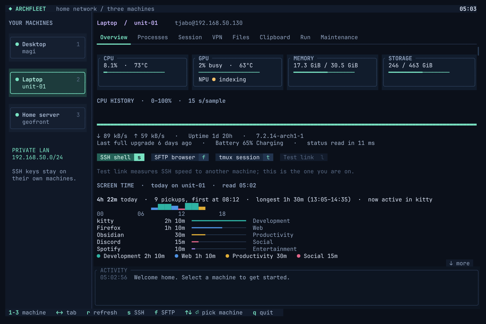
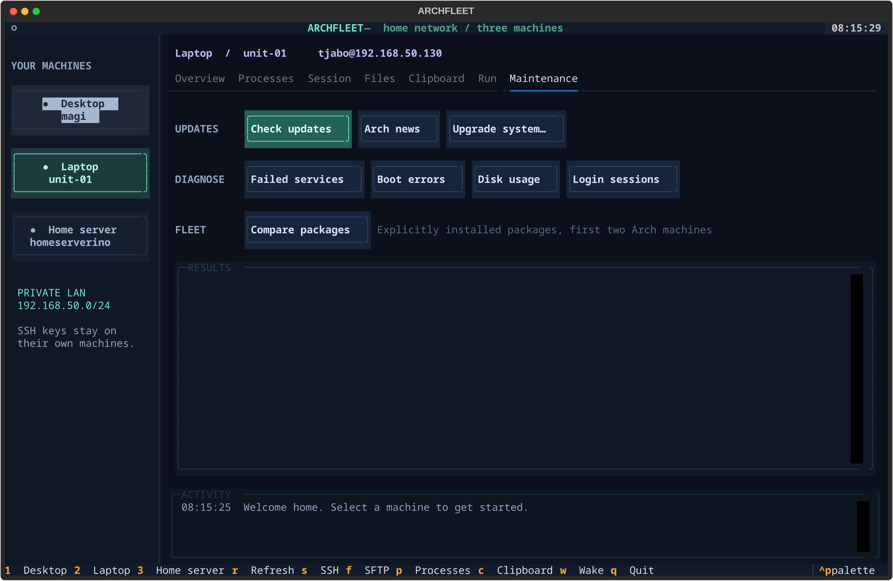

# Archfleet

A terminal dashboard for the handful of machines in your home: your Arch (or other Linux) desktop and
laptop, and optionally a Windows box. Everything goes over plain SSH. No agent to install on the
other machines, no open ports and no background services.



- **Overview**: CPU (with temperature), GPU busy and temperature, memory, every drive, network rate,
  uptime, battery, last full upgrade, CPU history, the status of the whole fleet, and an SSH link
  speed test.
- **Screen Time** (Overview, Arch machines): today's total, pickups, hourly bars and most used apps from
  [screentime](https://github.com/Tjabooo/screentime) (`screentime today --json` over SSH, every minute).
- **Wake-on-LAN**: a machine that's off gets a Wake button (or `archfleet --wake <alias>`).
- **Processes**: every process with its CPU, GPU, memory, disk and network use, sortable and
  filterable, plus machine totals. You can end your own processes.
- **Session** (Hyprland): peek at the screen, lock it, send a notification or open a link there;
  list monitors, workspaces and windows, switch workspace, focus a window, reload the config.
- **VPN**: every machine's VPN in one table (state, relay, exit IP, last drop) plus a column in the
  fleet table. Linux machines with the [Mullvad](https://mullvad.net) app: connect, disconnect,
  reconnect, switch relay. Windows machines: show a VPN watchdog's status file and run the restart /
  test commands you put in `hosts.json`.
- **Files**: SCP upload/download, plus SSH, SFTP and tmux shells.
- **Clipboard**: every machine's clipboard side by side. Copy between them with one key.
- **Run**: one command on several machines at once, with output grouped per machine.
- **Maintenance**: fresh update checks, Arch news since your last upgrade, failed services, boot
  errors, disk use, login sessions, a package diff between two machines, and interactive
  `pacman -Syu`.

It also comes with **clipdeck**, a SUPER+V clipboard picker overlay with one column per machine:
this machine's cliphist history, the other machines' histories, and Windows' native clipboard
history, paged so you can reach far back.

## Requirements

- Python 3.10+ and OpenSSH on each machine. Textual is installed into Archfleet's own venv.
- Linux machines: `sshd` running. For the clipboard you also need `wl-clipboard` and `cliphist`. The
  Session tab needs Hyprland, `grim` and `notify-send`.
- clipdeck needs [eww](https://github.com/elkowar/eww) and Hyprland.
- Windows (optional): Windows 10/11 with OpenSSH Server (the setup script installs it).

Arch: `sudo pacman -S --needed python openssh wl-clipboard cliphist grim libnotify` and eww from the AUR.

## Install

On every Linux machine:

```sh
git clone https://github.com/Tjabooo/archfleet.git
cd archfleet
./install.sh
```

This copies the app to `~/.local/share/archfleet`, builds its venv, adds `archfleet`,
`archfleet-clipboard` and `clipdeck` to `~/.local/bin`, adds an app-launcher entry, and creates
`~/.config/archfleet/hosts.json` the first time. Run it again to update.

### 1. List your machines

Edit `~/.config/archfleet/hosts.json` (start from [hosts.example.json](hosts.example.json)), using
the same file on every machine:

```json
[
  {"alias": "desktop", "label": "Desktop", "hostname": "my-desktop", "address": "192.168.1.20", "user": "me", "os": "linux", "mac": "00:11:22:33:44:55"},
  {"alias": "laptop",  "label": "Laptop",  "hostname": "my-laptop",  "address": "192.168.1.21", "user": "me", "os": "linux"},
  {"alias": "server",  "label": "Home server", "hostname": "my-server", "address": "192.168.1.10", "user": "me", "os": "windows"}
]
```

| Key | Meaning |
| --- | --- |
| `alias` | The SSH alias Archfleet connects to (`ssh <alias>` must work without a password) |
| `hostname` | The machine's real hostname. This is how Archfleet knows which entry is "this machine". |
| `label`, `address`, `user` | Shown in the UI. `address` is also used for the SSH aliases below. |
| `os` | `linux` or `windows` |
| `mac` | Optional: the wired MAC address, which enables Wake-on-LAN |
| `helper`, `clipboard_client` | Optional: non-default paths of the Linux helper / Windows clipboard client |
| `screentime_command` | Optional: how to run `screentime today --json` there (default: from `~/.local/bin` or `PATH`) |
| `marquee` | Optional: `true` on the machine running [Marquee](https://github.com/Tjabooo/marquee), to show its sharing load |
| `vpn` | Optional, see below |

The VPN tab finds the Mullvad app on Linux machines by itself. `vpn` adds what it can't guess:

```json
{"alias": "desktop", "vpn": {"state_file": "~/.local/state/my-rice/vpn.json"}}
{"alias": "server",  "vpn": {"status_file": "C:\\ProgramData\\MyVpn\\status.json",
                             "restart": "Restart-Service 'WireGuardTunnel$my-tunnel' -Force",
                             "test": "& 'C:\\tools\\Test-MyVpn.ps1'"}}
```

| Key | Meaning |
| --- | --- |
| `state_file` | Linux: a JSON file with `last_drop` (unix seconds), written by whatever watches the VPN there |
| `status_file` | Windows: a JSON status written by a VPN watchdog: `tunnel` (`up`/`down`), `server`, `exit` (`ok`, `ip`, `city`, `provider`), `problems`, `ok`, `at`, `lastDropAt`, `lastLeakAt` |
| `restart`, `test` | Windows: PowerShell run over SSH by the Restart tunnel / Test tunnel buttons |

Keys 1–9 select machines in the order listed.

### 2. SSH between the machines

If `ssh <alias>` already works without a password, skip this step. Otherwise run this on each machine:

```sh
python3 ~/.local/share/archfleet/setup_ssh.py          # aliases + a dedicated key, then prints what to authorise
python3 ~/.local/share/archfleet/setup_ssh.py --copy   # same, and runs ssh-copy-id for the Linux machines
python3 ~/.local/share/archfleet/setup_ssh.py --check  # once all are done: ssh + sftp round trip to each
```

The aliases go in `~/.ssh/config.d/archfleet.conf`, which is included from the top of
`~/.ssh/config`, and use their own key, `~/.ssh/id_ed25519_archfleet`. Your other SSH settings
aren't touched, and private keys never leave their machine.

### 3. Windows (optional)

In an **admin** PowerShell, from the cloned folder, allow your Linux machines' public keys
(`~/.ssh/id_ed25519_archfleet.pub` from each, one per line in a file):

```powershell
.\windows\setup-ssh-server.ps1 -PublicKeyFile C:\path\to\archfleet-keys.pub
```

This installs OpenSSH Server and allows key-only logins for your account. Port 22 is opened only to
your LAN (the PC's own /24 by default; change it with `-AllowFrom 10.0.0.0/24`), on the Private
network profile. The script refuses to replace an `sshd_config` it didn't write.

Then, as yourself (not elevated), install the clipboard bridge:

```powershell
powershell -ExecutionPolicy Bypass -File windows\install.ps1
```

SSH sessions on Windows can't see the desktop clipboard, so `clipboard-bridge.ps1` runs hidden in
your signed-in desktop session (the "Archfleet Clipboard Bridge" logon task). It answers only your
own account, through a local named pipe, so no network port is opened. To show Windows history in
clipdeck, turn on Settings → System → Clipboard → Clipboard history.

### 4. clipdeck (SUPER+V)

Add the binds to your Hyprland config:
[clipdeck/hyprland.lua](clipdeck/hyprland.lua) for a Lua config, or
[clipdeck/hyprland.conf](clipdeck/hyprland.conf) for a classic `hyprland.conf`. SUPER+V opens the
overlay. Each entry has a key chip (1–0, Q–P, A–L), and pressing the key or clicking the entry
copies it to this machine. Each column shows 10 entries a page and holds up to 100 (set
`CLIPDECK_HISTORY` to change that; Windows itself keeps 25): ←/→, Page Up/Down, Home/End or the
scroll wheel flip every column together, and the same keys then pick from the page shown. Esc or any
other key closes it.

Each other machine's last answer is cached in `~/.cache/clipdeck/` (readable only by you). SUPER+V shows
it straight away, marked "updating", while it asks the machine again, and keeps showing it, marked
offline, when the machine is off or asleep. Text entries (up to 64 KiB each) still copy from that copy;
images need the machine on. `CLIPDECK_CACHE=0` turns the cache off and `clipdeck forget` empties it.

If your eww config defines its own `clipdeck` window, copy the updated widget from
[clipdeck/eww/eww.yuck](clipdeck/eww/eww.yuck) to get the pager.

The overlay is an eww window. clipdeck uses the first eww config of yours that defines a
`clipdeck` window (`~/.config/eww` or any `~/.config/*/eww`), so it can wear your theme. Otherwise it
uses the bundled one in [clipdeck/eww](clipdeck/eww). To pick a config yourself, set `CLIPDECK_EWW`.

## Using it

Run `archfleet` or open **Archfleet** from your launcher.

Keys: 1–9 machines, P processes, O change process sort, C clipboard, W wake, R refresh, S SSH,
F SFTP, Q quit. Tab/Shift-Tab or the mouse for everything else.

From a shell, on Linux or Windows:

```sh
archfleet-clipboard get laptop              # print its clipboard text
archfleet-clipboard get server --json       # with images and the format
archfleet-clipboard copy desktop server     # desktop's clipboard -> server
wl-paste | archfleet-clipboard set laptop   # content on stdin, never as an argument
archfleet --wake desktop                    # Wake-on-LAN magic packet
```

On Windows the command is `%LOCALAPPDATA%\archfleet\archfleet-clipboard.cmd`. It reads the same
`~/.config/archfleet/hosts.json`.



## How it works

- `backend.py` talks to each machine. On Linux it sends a JSON request to `helper.py` over
  `ssh <alias> python3 ~/.local/share/archfleet/helper.py --stdin` (or runs it directly on this
  machine). On Windows it sends PowerShell scripts over SSH.
- Status is read every 15 seconds, the VPN state with it (`mullvad status --json` on Linux). Processes are read every 3 seconds, only while their tab is
  open. Session info is read only when you open that tab or press Refresh.
- Clipboard data travels inside the SSH connection's input and output, so it never shows up in
  process lists, shell history or logs. Text and PNG images up to 8 MiB are supported. While
  clipdeck is open, what it shows is kept in `$XDG_RUNTIME_DIR/clipdeck.json` (RAM, your user only),
  and the file is deleted on close. The other machines' last history (text up to 64 KiB an entry) is
  cached on disk in `~/.cache/clipdeck/` (folder 0700, files 0600), like cliphist's own database;
  `CLIPDECK_CACHE=0` turns that off and `clipdeck forget` deletes it.
- Everything runs as your own user. Without root, other users' processes show CPU and memory, but
  not their disk, GPU or network use. Per-process network counts TCP only (from `ss`). On Windows,
  the per-process I/O column includes network too, and processes there can't be ended from
  Archfleet.
- Wake-on-LAN sends a magic packet to the LAN broadcast addresses, then checks every 5 s for up to
  2 min. The machine needs Wake-on-LAN enabled in its firmware and on its network card. With
  NetworkManager: `nmcli connection modify "<connection>" 802-3-ethernet.wake-on-lan magic`.
- Test link: ping is the median time to open a TCP connection to port 22. Speed is 64 MB sent and
  received through SSH, with the login time taken out.

## Development

```sh
~/.local/share/archfleet/venv/bin/python -m unittest test_app.py test_processes.py
```

The tests use a fake backend and `test_hosts.json`, so they don't need a network.
`live_check.py`, `clipboard_check.py` and `transfer_check.py` are read-only checks against your real
machines. `preview.py` renders the screenshots in `docs/`.

## License

MIT
